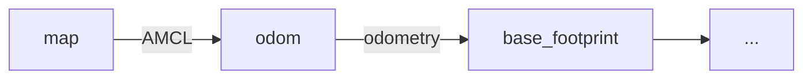
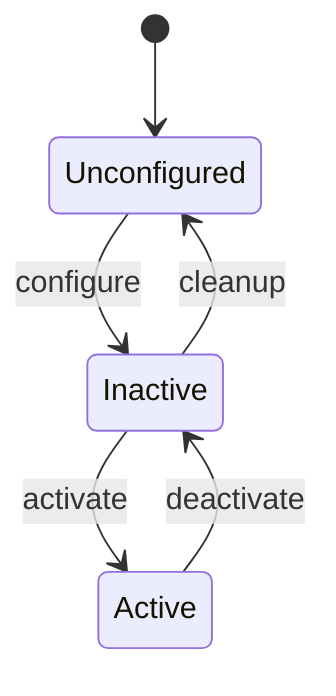

# Localization

With a saved map, the robot no longer needs to build the map every time it starts. Instead it needs to answer a simpler question: **where am I on this map?** That is **localization**. In this lesson you run **AMCL**, Nav2's localization node, on the map from the previous lesson, set the robot's initial pose, and watch AMCL keep track of the robot as it drives. You will also meet **lifecycle nodes**, which every Nav2 node is built on.

## Topics Covered

- Why odometry alone is not enough
- How AMCL works: a particle filter
- Lifecycle nodes and the lifecycle manager
- Running the map server and AMCL
- Setting the initial pose
- Important AMCL parameters

## In Simple Terms

Localization is **being dropped somewhere in a city you have a map of**: you look around, compare what you see with the map, and guess where you are. AMCL makes hundreds of guesses at once (**particles**); every time the robot moves and looks again, the guesses that don't match what it sees are thrown away, until only good ones remain.

**Example:** after you mark the robot's start on the map, the cloud of particles shrinks around the true position as the robot drives.

---

## Why Not Just Odometry?

Odometry integrates wheel motion over time, so its error only grows. You saw this in the [Spawning Robots](../08-simulation/spawning-robots.md#try-it-yourself) exercise: after driving a square, `/odom` no longer matched the robot's true position.

Localization fixes this by comparing what the robot **sees** (laser scans) with what it **expects to see** on the map from a given pose. Like SLAM, it publishes its correction as the `map → odom` transform:



The only difference from mapping: the map comes from a file and stays fixed.

---

## How AMCL Works

**AMCL** (Adaptive Monte Carlo Localization) represents its belief about the robot's pose as a cloud of **particles**. Each particle is a guess: "the robot might be here, facing this way".

```text
 1. Start: particles spread around the initial pose      · ·  ·  · ·
 2. Robot moves: every particle moves the same way,      ·  · · ·
    plus some noise (odometry is uncertain)
 3. New scan: particles whose expected view matches        ·:·
    the real scan get a high weight
 4. Resample: keep likely particles, drop unlikely ones     :
 5. Repeat: the cloud converges on the true pose
```

The pose AMCL reports is the weighted average of the particles. A **tight** cloud means AMCL is confident; a **spread** cloud means it is unsure. *Adaptive* refers to the number of particles: AMCL uses more when uncertain and fewer when confident, to save CPU.

AMCL needs the **initial pose** roughly right. With a good starting guess, it converges in a few seconds of driving.

---

## Lifecycle Nodes

All Nav2 servers, including the map server and AMCL, are **lifecycle nodes** (also called *managed nodes*). Unlike the nodes you wrote, they don't start working immediately. They move through defined states:



| State | Meaning |
|-------|---------|
| **Unconfigured** | Created, nothing loaded yet |
| **Inactive** | Parameters read, resources allocated (the map is loaded), but not processing |
| **Active** | Running: publishing, serving, computing |

This lets a system start in a controlled order (first load the map, then start localization) and restart parts cleanly. A **lifecycle manager** node drives the others through these transitions, in order. You will see it in the launch output.

```bash
$ ros2 lifecycle nodes            # list lifecycle nodes
$ ros2 lifecycle get /amcl        # current state, e.g. "active [3]"
```

> 💡 When a Nav2 node seems to do nothing, check its state with `ros2 lifecycle get`. A node stuck in `inactive` or `unconfigured` usually failed during configuration; the reason is in the launch output.

---

## Your Nav2 Parameter File

Nav2 is configured through one large YAML file. Start from the default shipped with `nav2_bringup` and copy it into your package, where you can adapt it:

```bash
$ cp $(ros2 pkg prefix --share nav2_bringup)/params/nav2_params.yaml \
     ~/ros2_ws/src/my_robot_navigation/config/nav2_params.yaml
```

The file has one section per node (`amcl:`, `map_server:`, `controller_server:`, ...). This lesson only touches the `amcl` section; the others follow in [Nav2](nav2.md).

Check that the AMCL frames and topic match `my_robot`; they do by default:

```yaml
amcl:
  ros__parameters:
    base_frame_id: "base_footprint"
    odom_frame_id: "odom"
    global_frame_id: "map"
    scan_topic: scan
    robot_model_type: "nav2_amcl::DifferentialMotionModel"
    ...
```

`DifferentialMotionModel` matches a robot that drives with two wheels and can't move sideways, like `my_robot`.

Rebuild the package so the file is installed:

```bash
$ cd ~/ros2_ws
$ colcon build --packages-select my_robot_navigation --symlink-install
```

---

## Running Localization

**Terminal 1**, the simulation:

```bash
$ ros2 launch my_robot_gazebo sim.launch.py use_rviz:=false
```

**Terminal 2**, map server and AMCL, using the `localization_launch.py` file from `nav2_bringup`:

```bash
$ ros2 launch nav2_bringup localization_launch.py \
    map:=$HOME/ros2_ws/src/my_robot_navigation/maps/my_map.yaml \
    params_file:=$HOME/ros2_ws/src/my_robot_navigation/config/nav2_params.yaml \
    use_sim_time:=true
...
[lifecycle_manager_localization]: Configuring map_server
[lifecycle_manager_localization]: Configuring amcl
[lifecycle_manager_localization]: Activating map_server
[lifecycle_manager_localization]: Activating amcl
[lifecycle_manager_localization]: Managed nodes are active
...
[amcl]: AMCL cannot publish a pose or update the transform. Please set the initial pose...
```

The last warning is expected: AMCL is waiting for you to tell it where the robot starts.

**Terminal 3**, RViz2 with the Nav2 configuration, which already contains the displays needed for navigation:

```bash
$ rviz2 -d $(ros2 pkg prefix --share nav2_bringup)/rviz/nav2_default_view.rviz \
    --ros-args -p use_sim_time:=true
```

The map appears, but no robot yet: without `map → odom`, RViz2 cannot place it in the `map` frame.

---

## Setting the Initial Pose

### In RViz2

1. Click **2D Pose Estimate** in the toolbar.
2. Click on the map where the robot is, and drag in the direction it is facing.

The robot model, the laser scan, and a cloud of small arrows (the **particles**) appear. If you placed the pose well, the laser points line up with the walls of the map.

Since slam_toolbox started the map at the robot's spawn position, the robot is at `(0, 0)`, facing along the map's x axis, if you spawned it with the defaults.

### From the command line

2D Pose Estimate simply publishes a message on `/initialpose`. You can publish it yourself:

```bash
$ ros2 topic pub --once /initialpose geometry_msgs/msg/PoseWithCovarianceStamped \
    "{header: {frame_id: map}, pose: {pose: {position: {x: 0.0, y: 0.0}, orientation: {w: 1.0}}}}"
```

### From the parameter file

For a robot that always starts in the same place, set it in `nav2_params.yaml`:

```yaml
amcl:
  ros__parameters:
    set_initial_pose: true
    initial_pose:
      x: 0.0
      y: 0.0
      z: 0.0
      yaw: 0.0
```

---

## Watching AMCL Work

Drive the robot with `teleop_twist_keyboard` and watch the particle cloud:

- While standing still, the cloud stays as it is: AMCL only updates after the robot has moved a little (`update_min_d`, `update_min_a`).
- While driving, the cloud **shrinks** around the true pose as scans confirm it.
- The laser scan stays aligned with the map walls, even after long drives. That is the correction odometry alone can't provide.

```bash
$ ros2 topic echo /amcl_pose --once         # AMCL's pose estimate with covariance
$ ros2 run tf2_ros tf2_echo map odom        # the correction AMCL publishes
```

Try a bad initial pose: set it 1 m away from the true position, or facing the wrong way. The scan no longer matches the walls. Drive around: AMCL may recover from small errors, but with a large one it locks onto the wrong pose. A good initial pose matters.

---

## Important AMCL Parameters

| Parameter | Default | Meaning |
|-----------|---------|---------|
| `min_particles`, `max_particles` | 500, 2000 | Range of particle counts. More is more robust but slower |
| `update_min_d`, `update_min_a` | 0.25 m, 0.2 rad | Movement needed before a filter update |
| `alpha1` … `alpha5` | 0.2 | Expected odometry noise. Increase if odometry is poor |
| `laser_model_type` | `likelihood_field` | How scans are compared with the map |
| `max_beams` | 60 | How many rays of each scan are used |
| `transform_tolerance` | 1.0 s | How long the published `map → odom` stays valid |

The defaults work well for a small indoor robot like `my_robot`. Change one value at a time and observe the effect.

---

## Common Problems

| Symptom | Cause / fix |
|---------|-------------|
| `Please set the initial pose...` keeps appearing | No initial pose received; use 2D Pose Estimate or `set_initial_pose` |
| The map doesn't appear in RViz2 | Wrong `map:=` path (use an absolute path), or the map server isn't active (`ros2 lifecycle get /map_server`) |
| The laser doesn't match the walls | Wrong initial pose; set it again more carefully |
| `Message Filter dropping message: frame 'laser'` | Missing TF to `laser`, or `use_sim_time` mismatch |
| Lifecycle manager reports a node failed to configure | Error in the parameter file or a missing file; read the first error in the output |

---

## Try It Yourself

1. Set the initial pose 90° wrong and drive around. Does AMCL recover?
2. Reduce `max_particles` to 100 and repeat. What changes?
3. Configure `set_initial_pose` in `nav2_params.yaml` so localization works immediately after launch.
4. Write a Python node that subscribes to `/amcl_pose` and logs the robot's position and the uncertainty (the covariance values for x and y) once per second.
5. **Kidnapped robot:** teleport the robot in Gazebo with `gz service -s /world/my_world/set_pose --reqtype gz.msgs.Pose --reptype gz.msgs.Boolean --timeout 1000 --req 'name: "my_robot", position: {x: 1.5, y: -1.5}'`. What does AMCL do? How do you fix it?

---

⬅️ [Previous: Mapping (SLAM)](mapping.md) | [⬆️ Navigation & SLAM](README.md) | [Next: Nav2](nav2.md) ➡️
