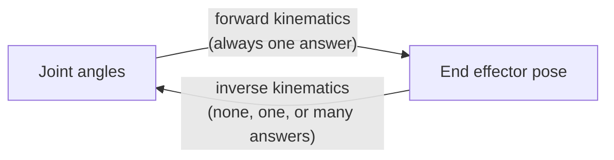
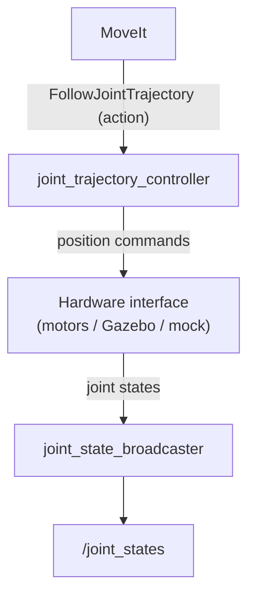

# Robot Arms

Before planning motions with MoveIt, you need the vocabulary and the core ideas of robot arms: links and joints, degrees of freedom, the end effector, the workspace, and above all **kinematics**, the math that connects joint angles to where the gripper is. In this lesson you build a small arm model, move it with sliders, and compute its kinematics in Python.

## Topics Covered

- Anatomy of a robot arm
- Degrees of freedom and the workspace
- Joint space vs Cartesian space
- Forward kinematics
- Inverse kinematics
- Trajectories
- How arms are controlled in ROS 2: `ros2_control`

## In Simple Terms

Look at **your own arm**: shoulder, elbow, and wrist are joints, and your hand is the end effector. **Forward kinematics** is "if I bend my elbow 90°, where is my hand?", which is easy to answer. **Inverse kinematics** is "I want my hand on that cup, how should I bend my joints?", which is harder, and often has several answers (elbow up or elbow down).

**Example:** the Python script finds two different ways for a 2-link arm to reach the same point, and none for a point that is too far away.

---

## Anatomy of a Robot Arm

```text
                     link 2
          joint 2 ●━━━━━━━━━━━━● joint 3
                 ┃              ┃ link 3
         link 1  ┃              ┃
                 ┃              ◆ end effector (gripper)
          joint 1 ●
          ════════╧════════  base
```

| Part | Meaning |
|------|---------|
| **Base** | The fixed part, mounted on a table, the floor, or a mobile robot |
| **Links** | The rigid segments of the arm |
| **Joints** | The motors between links. Arms almost always use **revolute** joints, sometimes **prismatic** ones |
| **End effector** | The tool at the end of the arm: a gripper, a suction cup, a welding torch |
| **TCP** (Tool Center Point) | The point of the end effector that matters for the task, e.g. between the gripper fingers |

You already know how to describe links and joints: arms are modeled in URDF/Xacro exactly like the mobile robot in [Module 07](../07-robot-modeling/urdf.md), with `revolute` joints and limits.

---

## Degrees of Freedom and the Workspace

The **degrees of freedom (DOF)** of an arm is the number of joints it can move independently.

| DOF | What it can do |
|-----|----------------|
| 2–3 | Reach positions in a plane or a limited volume, but not choose the orientation freely |
| **6** | Reach any position **and** any orientation within its workspace. The minimum for general manipulation |
| 7 | One extra joint: the same gripper pose can be reached with different arm configurations, which helps avoid obstacles (the Panda has 7 DOF, like a human arm) |

A pose in 3D has 6 numbers: position (x, y, z) and orientation (roll, pitch, yaw). That's why 6 DOF is needed to control both.

The **workspace** is the set of all positions the end effector can reach. It is limited by the link lengths and the joint limits.

---

## Joint Space vs Cartesian Space

There are two ways to describe where an arm is:

| | Joint space | Cartesian space |
|---|---|---|
| Describes | The angle of every joint | The pose of the end effector |
| Example | `[0.0, -0.78, 0.0, -2.35, 0.0, 1.57, 0.78]` (7 angles) | position `(0.3, 0.0, 0.5)`, gripper pointing down |
| Natural for | The motors | The task ("put the gripper there") |

Converting between the two is what **kinematics** does.



---

## Forward Kinematics

**Forward kinematics (FK):** given the joint angles, compute where the end effector is. This is always possible and has exactly one answer. In ROS 2, `robot_state_publisher` effectively does forward kinematics: it chains the joint transforms of the URDF to publish every link's pose in TF.

For a simple **planar 2-link arm** with link lengths `l1`, `l2` and joint angles `θ1`, `θ2`:

```text
          ● (x, y) end effector
         ╱
     l2 ╱  θ2
       ●───── ─ ─
      ╱
  l1 ╱  θ1
    ●───────── ─ ─  x
```

```text
x = l1·cos(θ1) + l2·cos(θ1 + θ2)
y = l1·sin(θ1) + l2·sin(θ1 + θ2)
```

## Inverse Kinematics

**Inverse kinematics (IK):** given a desired end effector pose, find joint angles that reach it. This is what you need for tasks ("grasp the cup **there**"), and it is harder:

- There may be **no** solution (the target is outside the workspace).
- There may be **several** solutions. The 2-link arm can reach most points "elbow up" or "elbow down".
- For arms with 7 DOF there are **infinitely many** solutions.
- For most arms there is no simple formula; IK is solved **numerically**, by iteratively adjusting the joints until the end effector is close enough to the target.

For the 2-link arm, a closed-form solution exists. Here are FK and IK in Python; create `~/arm_kinematics.py` (it doesn't need ROS):

```python
import math

L1, L2 = 0.3, 0.25  # link lengths in meters


def forward(theta1, theta2):
    x = L1 * math.cos(theta1) + L2 * math.cos(theta1 + theta2)
    y = L1 * math.sin(theta1) + L2 * math.sin(theta1 + theta2)
    return x, y


def inverse(x, y, elbow_up=True):
    """Return (theta1, theta2) reaching (x, y), or None if unreachable."""
    cos_t2 = (x ** 2 + y ** 2 - L1 ** 2 - L2 ** 2) / (2 * L1 * L2)
    if abs(cos_t2) > 1.0:
        return None  # outside the workspace
    theta2 = math.acos(cos_t2)
    if elbow_up:
        theta2 = -theta2
    theta1 = math.atan2(y, x) - math.atan2(L2 * math.sin(theta2), L1 + L2 * math.cos(theta2))
    return theta1, theta2


if __name__ == '__main__':
    target = (0.35, 0.2)
    for elbow_up in (True, False):
        solution = inverse(*target, elbow_up=elbow_up)
        t1, t2 = solution
        print(f'elbow_up={elbow_up}: theta1={math.degrees(t1):6.1f}°, '
              f'theta2={math.degrees(t2):6.1f}°  -> FK check {forward(t1, t2)}')
    print('Unreachable target:', inverse(1.0, 0.0))
```

```bash
$ python3 ~/arm_kinematics.py
elbow_up=True: theta1=  68.0°, theta2= -86.2°  -> FK check (0.35..., 0.2...)
elbow_up=False: theta1=  -8.5°, theta2=  86.2°  -> FK check (0.35..., 0.2...)
Unreachable target: None
```

Two different joint configurations reach the same point, and a target 1 m away is unreachable for an arm that is 0.55 m long. MoveIt handles all of this for real arms with **kinematics plugins** (KDL by default), as you will see in the [next lesson](moveit.md).

---

## Building `my_arm`

Let's make the concepts visible. Create `~/ros2_ws/src/my_robot_description/urdf/my_arm.urdf.xacro`, a 3-joint arm: a rotating base (yaw) and two links that pitch up and down.

```xml
<?xml version="1.0"?>
<robot name="my_arm" xmlns:xacro="http://www.ros.org/wiki/xacro">

  <xacro:include filename="inertial_macros.xacro"/>

  <xacro:property name="link_radius" value="0.025"/>
  <xacro:property name="l1" value="0.3"/>
  <xacro:property name="l2" value="0.25"/>

  <material name="orange"><color rgba="1.0 0.5 0.1 1.0"/></material>
  <material name="grey"><color rgba="0.6 0.6 0.6 1.0"/></material>

  <link name="world"/>

  <link name="base">
    <visual>
      <origin xyz="0 0 0.025"/>
      <geometry><cylinder radius="0.08" length="0.05"/></geometry>
      <material name="grey"/>
    </visual>
  </link>
  <joint name="base_fixed" type="fixed">
    <parent link="world"/>
    <child link="base"/>
  </joint>

  <!-- Joint 1: rotate the whole arm around the vertical axis -->
  <link name="shoulder">
    <visual>
      <origin xyz="0 0 0.05"/>
      <geometry><cylinder radius="0.04" length="0.1"/></geometry>
      <material name="orange"/>
    </visual>
  </link>
  <joint name="joint1" type="revolute">
    <parent link="base"/>
    <child link="shoulder"/>
    <origin xyz="0 0 0.05"/>
    <axis xyz="0 0 1"/>
    <limit lower="${-pi}" upper="${pi}" velocity="1.0" effort="10.0"/>
  </joint>

  <!-- Link macro: a cylinder of a given length pointing along x -->
  <xacro:macro name="arm_link" params="name length">
    <link name="${name}">
      <visual>
        <origin xyz="${length / 2} 0 0" rpy="0 ${pi / 2} 0"/>
        <geometry><cylinder radius="${link_radius}" length="${length}"/></geometry>
        <material name="orange"/>
      </visual>
      <collision>
        <origin xyz="${length / 2} 0 0" rpy="0 ${pi / 2} 0"/>
        <geometry><cylinder radius="${link_radius}" length="${length}"/></geometry>
      </collision>
    </link>
  </xacro:macro>

  <!-- Joint 2: shoulder pitch -->
  <xacro:arm_link name="upper_arm" length="${l1}"/>
  <joint name="joint2" type="revolute">
    <parent link="shoulder"/>
    <child link="upper_arm"/>
    <origin xyz="0 0 0.1" rpy="0 ${-pi / 2} 0"/>
    <axis xyz="0 1 0"/>
    <limit lower="${-pi / 2}" upper="${pi / 2}" velocity="1.0" effort="10.0"/>
  </joint>

  <!-- Joint 3: elbow pitch -->
  <xacro:arm_link name="forearm" length="${l2}"/>
  <joint name="joint3" type="revolute">
    <parent link="upper_arm"/>
    <child link="forearm"/>
    <origin xyz="${l1} 0 0"/>
    <axis xyz="0 1 0"/>
    <limit lower="${-2.5}" upper="${2.5}" velocity="1.0" effort="10.0"/>
  </joint>

  <!-- The tool center point at the tip of the forearm -->
  <link name="tool"/>
  <joint name="tool_joint" type="fixed">
    <parent link="forearm"/>
    <child link="tool"/>
    <origin xyz="${l2} 0 0"/>
  </joint>

</robot>
```

At zero angles, the arm points straight up; `joint2` and `joint3` tilt the links, and `joint1` turns the whole arm. View it with the commands from the [URDF](../07-robot-modeling/urdf.md#viewing-the-robot) lesson:

```bash
$ cd ~/ros2_ws/src/my_robot_description/urdf
$ ros2 run robot_state_publisher robot_state_publisher \
    --ros-args -p robot_description:="$(xacro my_arm.urdf.xacro)"
$ ros2 run joint_state_publisher_gui joint_state_publisher_gui
$ rviz2       # Fixed Frame: world; add RobotModel (/robot_description) and TF
```

Move the sliders. Then watch **forward kinematics** happen live:

```bash
$ ros2 run tf2_ros tf2_echo world tool
```

As you move the sliders, `tf2_echo` prints the tool's position: `robot_state_publisher` computes FK from the joint angles and the URDF. Set `joint1 = 0` and compare the tool's position with your `forward()` function. (In the arm's vertical plane, the "x" of the Python script is the horizontal distance and "y" is the height above the shoulder.)

---

## Trajectories

To move an arm, it's not enough to know the goal angles. The joints must move **together**, smoothly, respecting velocity and acceleration limits, without hitting anything on the way. A **trajectory** describes this motion as a sequence of points in joint space, each with a time:

```bash
$ ros2 interface show trajectory_msgs/msg/JointTrajectory
std_msgs/Header header
string[] joint_names
JointTrajectoryPoint[] points
        float64[] positions
        float64[] velocities
        float64[] accelerations
        float64[] effort
        builtin_interfaces/Duration time_from_start
```

Computing a collision-free trajectory is **motion planning**, the job of MoveIt (next lesson). Executing it on the motors is the job of a controller.

---

## Controlling Arms: `ros2_control`

On real robots, and in simulation, arms are usually driven through **`ros2_control`**, the ROS 2 framework for controllers and hardware interfaces:



| Component | Role |
|-----------|------|
| **Controller manager** | Loads and runs controllers in a real-time loop |
| **Hardware interface** | Talks to the actual motors, to Gazebo, or to a "mock" that pretends to be hardware |
| **`joint_trajectory_controller`** | Executes trajectories received via the `FollowJointTrajectory` action |
| **`joint_state_broadcaster`** | Publishes the measured joint positions on `/joint_states` |

The same controllers work with real hardware, with Gazebo, and with mock hardware, which is exactly how the MoveIt demo in the next lesson runs without a robot. Setting up `ros2_control` for your own robot is beyond this introduction; the [ros2_control documentation](https://control.ros.org/) is the place to continue.

---

## Try It Yourself

1. Use the sliders to find the tool's highest and farthest reachable points. How do they relate to `l1 + l2`?
2. Extend `arm_kinematics.py` with a function that prints whether a list of points is reachable.
3. Use `inverse()` to compute angles for a target, set them with the sliders (`joint2` and `joint3`, with `joint1 = 0`), and check with `tf2_echo` that the tool reaches it. Mind the axis directions and that the arm starts pointing up.
4. Add a fourth joint to `my_arm`: a wrist that rotates around the forearm's axis. How many DOF does the arm have now, and what can it do that it couldn't before?
5. Look at the Panda's joint limits: `ros2 launch moveit_resources_panda_moveit_config demo.launch.py` and `ros2 topic echo /robot_description --once`, then search for `<limit`.

---

[⬆️ Manipulation](README.md) | [Next: MoveIt 2](moveit.md) ➡️
