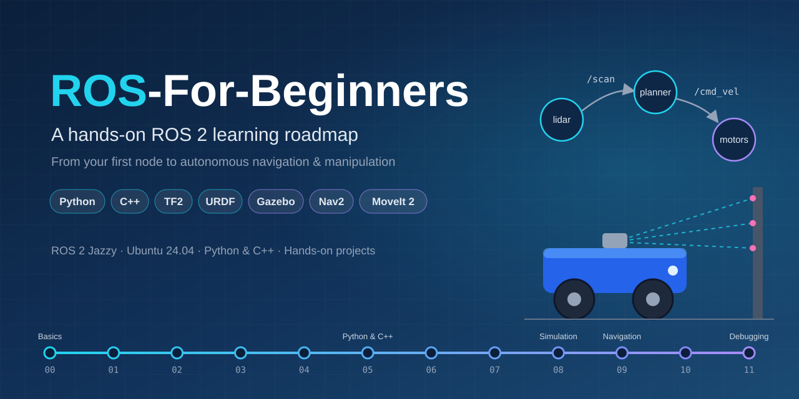

<p align="center">
  
</p>

# 🤖 ROS-For-Beginners
Welcome to **ROS-For-Beginners**! This repository is designed as a structured, hands-on, and beginner-friendly roadmap to learning **ROS 2 (Robot Operating System)** from scratch.

Whether you are a student, hobbyist, or software engineer transitioning into robotics, this guide will take you step-by-step from fundamental prerequisites to advanced autonomous navigation and manipulation.

---

## 🗺️ Learning Roadmap

The content is organized into progressive modules. We recommend following them in order:

### 00. Prerequisites
- [Linux Basics](00-prerequisites/linux-basics.md)
- [Git Basics](00-prerequisites/git-basics.md)
- [Python Basics](00-prerequisites/python-basics.md)

### 01. ROS 2 Core Concepts
- [What is ROS 2?](01-ros2-basics/what-is-ros2.md)
- [ROS 2 Architecture](01-ros2-basics/ros2-architecture.md)
- [Nodes](01-ros2-basics/nodes.md) | [Topics](01-ros2-basics/topics.md) | [Services](01-ros2-basics/services.md) | [Actions](01-ros2-basics/actions.md)
- [Parameters](01-ros2-basics/parameters.md) & [Launch Files](01-ros2-basics/launch-files.md)

### 02. CLI Tools
Master the essential command-line interface tools to introspect running ROS 2 systems:
- [`ros2 node`](02-ros2-cli/ros2-node.md) | [`ros2 topic`](02-ros2-cli/ros2-topic.md) | [`ros2 service`](02-ros2-cli/ros2-service.md) | [`ros2 action`](02-ros2-cli/ros2-action.md)
- [`ros2 param`](02-ros2-cli/ros2-param.md) | [`ros2 run`](02-ros2-cli/ros2-run.md) | [`ros2 launch`](02-ros2-cli/ros2-launch.md)

### 03. Workspaces & Packages
Learn how ROS 2 manages software builds:
- [Workspaces](03-workspaces-and-packages/workspace.md) | [Packages](03-workspaces-and-packages/packages.md) | [colcon](03-workspaces-and-packages/colcon.md)
- [package.xml](03-workspaces-and-packages/package-xml.md) & [setup.py](03-workspaces-and-packages/setup-py.md)

### 04. ROS 2 Client Libraries: Python (rclpy)
Hands-on implementation of the core communication mechanisms in Python:
- [Publisher](04-python/publisher.md) | [Subscriber](04-python/subscriber.md)
- [Services](04-python/services.md) | [Actions](04-python/actions.md)
- [Custom Interfaces](04-python/custom-messages.md)

### 05. ROS 2 Client Libraries: C++ (rclcpp)
Modern C++ implementations of the same mechanisms:
- [Publisher](05-cpp/publisher.md) | [Subscriber](05-cpp/subscriber.md)
- [Services](05-cpp/services.md) | [Actions](05-cpp/actions.md)

### 06. Transform Library (TF2)
Track coordinate frames and convert data between them:
- [Coordinate Frames](06-tf2/coordinate-frames.md)
- [TF2 Broadcasters](06-tf2/tf2-broadcaster.md) | [TF2 Listeners](06-tf2/tf2-listener.md)
- [TF2 Tools](06-tf2/tf2-tools.md)

### 07. Robot Modeling
Describe a robot so ROS 2 tools can visualize and simulate it:
- [URDF](07-robot-modeling/urdf.md) & [Xacro](07-robot-modeling/xacro.md)
- [robot_state_publisher](07-robot-modeling/robot-state-publisher.md)
- [RViz2](07-robot-modeling/rviz.md)

### 08. Simulation
Bring your robot to life in Gazebo with physics and simulated sensors:
- [Gazebo](08-simulation/gazebo.md)
- [Spawning Robots](08-simulation/spawning-robots.md) | [Sensors](08-simulation/sensors.md)
- [Simulation Project](08-simulation/simulation-project.md)

### 09. Navigation & SLAM
Build maps, localize, and navigate autonomously with Nav2:
- [Mapping (SLAM)](09-navigation/mapping.md) | [Localization](09-navigation/localization.md)
- [Nav2](09-navigation/nav2.md)
- [Autonomous Navigation](09-navigation/autonomous-navigation.md)

### 10. Manipulation
Plan and execute arm motions with MoveIt 2:
- [Robot Arms](10-manipulation/robot-arms.md)
- [MoveIt 2](10-manipulation/moveit.md)
- [Manipulation Project](10-manipulation/manipulation-project.md)

### 11. Debugging & Troubleshooting
Find out why a ROS 2 system isn't doing what you expect:
- [Common Errors](11-debugging/common-errors.md) | [ros2 doctor](11-debugging/ros2-doctor.md)
- [rosbag2](11-debugging/rosbag.md)
- [Debugging Workflow](11-debugging/debugging-workflow.md)

---

## 🚀 Hands-on Projects

Apply what you've learned through incremental projects:

1. **`01-turtlesim`**: Getting started with basic velocity commands and telemetry.
2. **`02-obstacle-avoidance`**: Sensor data integration for basic collision prevention.
3. **`03-mapping`**: Building 2D grid maps using simulated LiDAR.
4. **`04-autonomous-navigation`**: Waypoint navigation in dynamic environments.
5. **`05-final-project`**: End-to-end integration combining simulation, navigation, and manipulation.

---

## 🛠️ Recommended Setup

- **OS:** Ubuntu 22.04 LTS (Jammy Jellyfish) or Ubuntu 24.04 LTS
- **ROS 2 Version:** ROS 2 Humble Hawksbill (LTS) or ROS 2 Jazzy Jalisco (LTS)
- **Language Requirements:** Python 3.10+ / C++17

---

## 🤝 Contributing

Contributions are what make the open-source community an amazing place to learn, inspire, and create. Any contributions you make are **greatly appreciated**!

Please check [CONTRIBUTING.md](CONTRIBUTING.md) before submitting a Pull Request.

---

## 📁 Repository Structure

```text
ROS-For-Beginners/
│
├── README.md
├── CONTRIBUTING.md
├── LICENSE
├── assets/
│   └── cover.svg
│
├── 00-prerequisites/
│   ├── README.md
│   ├── linux-basics.md
│   ├── git-basics.md
│   └── python-basics.md
│
├── 01-ros2-basics/
│   ├── README.md
│   ├── what-is-ros2.md
│   ├── ros2-architecture.md
│   ├── nodes.md
│   ├── topics.md
│   ├── services.md
│   ├── actions.md
│   ├── parameters.md
│   └── launch-files.md
│
├── 02-ros2-cli/
│   ├── README.md
│   ├── ros2-node.md
│   ├── ros2-topic.md
│   ├── ros2-service.md
│   ├── ros2-action.md
│   ├── ros2-param.md
│   ├── ros2-run.md
│   └── ros2-launch.md
│
├── 03-workspaces-and-packages/
│   ├── README.md
│   ├── workspace.md
│   ├── packages.md
│   ├── colcon.md
│   ├── package-xml.md
│   └── setup-py.md
│
├── 04-python/
│   ├── README.md
│   ├── publisher.md
│   ├── subscriber.md
│   ├── services.md
│   ├── actions.md
│   └── custom-messages.md
│
├── 05-cpp/
│   ├── README.md
│   ├── publisher.md
│   ├── subscriber.md
│   ├── services.md
│   └── actions.md
│
├── 06-tf2/
│   ├── README.md
│   ├── coordinate-frames.md
│   ├── tf2-broadcaster.md
│   ├── tf2-listener.md
│   └── tf2-tools.md
│
├── 07-robot-modeling/
│   ├── README.md
│   ├── urdf.md
│   ├── xacro.md
│   ├── robot-state-publisher.md
│   └── rviz.md
│
├── 08-simulation/
│   ├── README.md
│   ├── gazebo.md
│   ├── spawning-robots.md
│   ├── sensors.md
│   └── simulation-project.md
│
├── 09-navigation/
│   ├── README.md
│   ├── mapping.md
│   ├── localization.md
│   ├── nav2.md
│   └── autonomous-navigation.md
│
├── 10-manipulation/
│   ├── README.md
│   ├── robot-arms.md
│   ├── moveit.md
│   └── manipulation-project.md
│
├── 11-debugging/
│   ├── README.md
│   ├── common-errors.md
│   ├── ros2-doctor.md
│   ├── rosbag.md
│   └── debugging-workflow.md
│
└── projects/
    ├── 01-turtlesim/
    ├── 02-obstacle-avoidance/
    ├── 03-mapping/
    ├── 04-autonomous-navigation/
    └── 05-final-project/
```
---

## 📜 License

Distributed under the MIT License. See `LICENSE` for more information.
